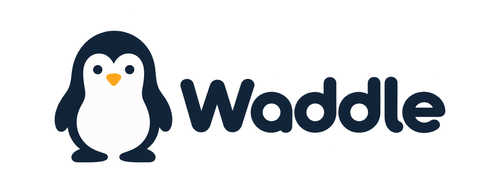

# Waddle



Waddle is a local desktop workspace for checking how your website appears in Google Search AI Overviews, exploring citation evidence, crawling your own pages, and turning evidence into page-improvement briefs and tasks.


## Features

- Track search phrases and save AI Overview evidence and screenshots.
- Compare citation history, cited pages, recurring domains and competitors.
- Crawl your own website with robots, redirect, domain and size safeguards.
- Review pages with local Ollama models and create editable briefs and tasks.
- Keep workspace data locally in SQLite with automatic backups.
- No build step and no cloud AI inference. SERP collection uses the configured Bright Data connection.

## Requirements

- Windows 10 or later
- Python 3.10 or later
- A Bright Data account and accessible SERP zone for live Google collection
- Ollama is optional and only needed for local page reviews

## Install and run

1. Download or clone this repository.
2. Open PowerShell in the repository folder.
3. Create a virtual environment and install the one dependency:

   ```powershell
   python -m venv .venv
   .venv\Scripts\python.exe -m pip install -r requirements.txt
   ```

4. Double-click `Launch.cmd`, or run:

   ```powershell
   .\Launch.ps1
   ```

Waddle opens at `http://127.0.0.1:8765/`. The launcher prefers `.venv` when it exists and otherwise uses Python on PATH.

## First use

Create a project, enter your website and search phrases, then open Settings to add and test the Bright Data connection. Start with one selected search before checking all searches. Waddle does not begin a search or crawl merely because a project is created.

For local page reviews, install and run [Ollama](https://ollama.com/), then select an installed text model in **Settings → Local AI — Ollama**. Reviews never send content to a cloud AI provider.

## Data and privacy

Workspace data is stored at:

```text
%LOCALAPPDATA%\AIOverviewTool\workspace.sqlite3
```

Waddle keeps this directory name so existing workspaces remain available. Moving the repository does not move or delete the workspace. Backups are created automatically. Credentials are protected with Windows DPAPI and are tied to the Windows user who saved them.

Waddle only accepts public HTTP(S) website URLs for crawling. It respects robots rules, validates redirects, limits downloads, and does not execute JavaScript or solve CAPTCHAs.

## Development checks

The application itself has no build step. If you are changing the code, useful checks are:

```powershell
.venv\Scripts\python.exe -m unittest discover -s tests -v
node --check web/app.js
```

The `tests/` directory is intentionally not part of the runtime distribution described by this README.

## Licence

No licence has been declared yet. Add one before redistributing Waddle.
